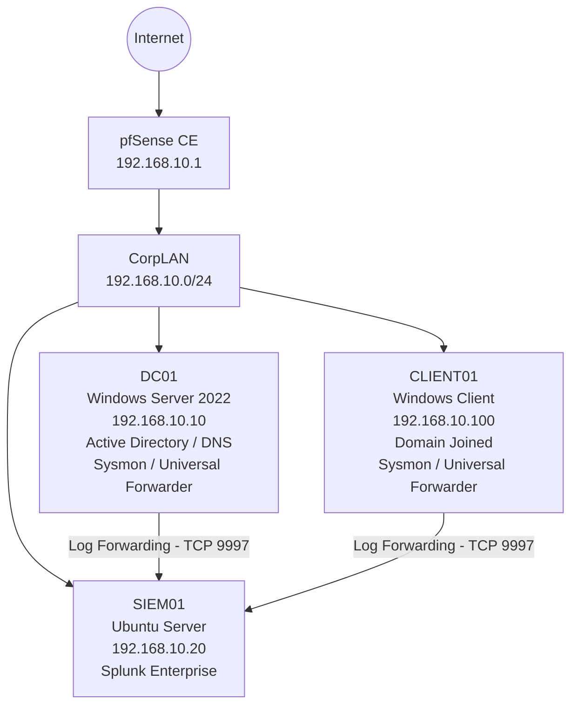

# SOC Home Lab Network Topology

## Network Overview

The lab uses a VirtualBox internal network named `CorpLAN` with the subnet `192.168.10.0/24`.

## System Roles

| System | IP Address | Role |
|---|---|---|
| pfSense | 192.168.10.1 | Firewall and network gateway |
| DC01 | 192.168.10.10 | Active Directory and DNS |
| CLIENT01 | 192.168.10.100 | Domain-joined Windows endpoint |
| SIEM01 | 192.168.10.20 | Centralized log collection and analysis |

## Monitoring Architecture

- Sysmon collects endpoint activity.
- Splunk Universal Forwarder sends Windows events to SIEM01.
- Splunk Enterprise receives events on TCP port 9997.
- Splunk Web provides the monitoring interface on TCP port 8000.

## Network Purpose

This isolated lab environment provides a foundation for practicing centralized logging, Windows security monitoring, authentication investigations, and threat detection.
