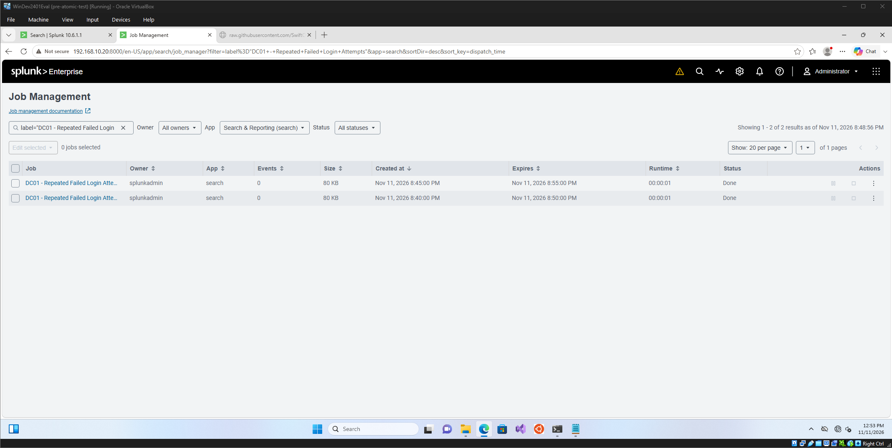
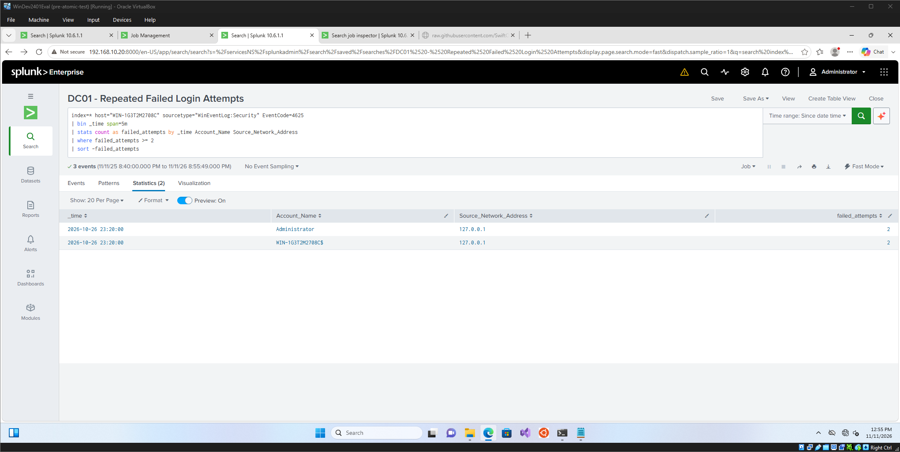

# Failed Login Alert Test: Brute Force Detection (T1110)

## Objective

Confirm that a scheduled Splunk alert detects repeated failed logins (Windows Event ID 4625) on the domain controller and surfaces them for investigation.

## Technique

| Field | Value |
|---|---|
| MITRE ATT&CK Technique | Brute Force |
| Technique ID | T1110 |
| Tactic | Credential Access |
| Telemetry | Windows Security Event ID 4625 |

## Environment

- Monitored system: DC01, Windows Server 2022 domain controller (Splunk host name: WIN-1G3T2M2708C)
- Telemetry: Windows Security log forwarded to Splunk by the Universal Forwarder
- Splunk index: main
- Test date: 2026-11-11

## Alert Configuration

| Setting | Value |
|---|---|
| Name | DC01 - Repeated Failed Login Attempts |
| Description | Detects 2 or more failed login attempts within 5 minutes on DC01 |
| Type | Scheduled |
| Schedule | Every 5 minutes (`*/5 * * * *`) |
| Time range | Last 300 seconds |
| Trigger condition | Number of results is greater than 0 |
| Throttle | Suppress for 5 minutes |
| Severity | Medium |
| Action | Add to Triggered Alerts |

Alert search:

```spl
[Paste the search from Settings → Searches, reports, and alerts → the alert → Edit → Edit Search]
```

## What I Did

[Describe how you triggered it: which account you used, how many wrong passwords you entered, on which machine, and over what time span. For example: "I entered an incorrect password 3 times for the account `test` at the DC01 sign-in prompt within 2 minutes."]

## What the Alert Showed

The alert appeared under Activity → Triggered Alerts after its next scheduled run.





[Add one or two sentences: the account name and failure count in the results, and the time the alert fired.]

## Observations

- **Machine accounts add noise.** Failed-login data also included the domain controller's own computer account (`WIN-1G3T2M2708C$`) with source address 127.0.0.1. Accounts ending in `$` are machine accounts, and their local failures are normal background activity, so a tuned version of the alert would exclude them.
- **Clock drift delayed the first test.** DC01's events were timestamped about 2 hours 34 minutes ahead of the time Splunk received them. The alert only searches the last 300 seconds, so future-dated events fell outside its window and the scheduled runs returned 0 events. [State what you did to fix it, and confirm that new events now show a lag near 0 seconds.]
- **The threshold is deliberately low.** Two failures in five minutes is set for lab testing. A production threshold would be higher, and would account for normal mistyped passwords.

## False Positives

Users mistyping passwords, expired or recently changed passwords, service accounts with stale credentials, and mapped drives or scheduled tasks using old credentials can all trigger this alert. I would separate them from a brute-force attempt by checking whether failures target many accounts or one, whether they come from one source, and whether a successful login (Event ID 4624) follows the failures.

## Limitations

- This was a single manual test in an isolated lab.
- A failed login alone does not establish a brute-force attack. Context is required.
- The alert is scoped to DC01. [Add: "A matching alert for CLIENT01 is planned." or "A matching alert for CLIENT01 is configured." depending on whether you cloned it.]

## Result

| Item | Outcome |
|---|---|
| Failed logins generated | Yes |
| Events visible in Splunk | Yes |
| Alert fired | Yes |
| ATT&CK status | Alert configured and tested |

## Next Steps

- Exclude machine accounts from the alert search.
- Add a correlated search for failures followed by a successful login (4625 then 4624).
- Clone the alert for CLIENT01.
- Raise the threshold and test it against normal activity.
