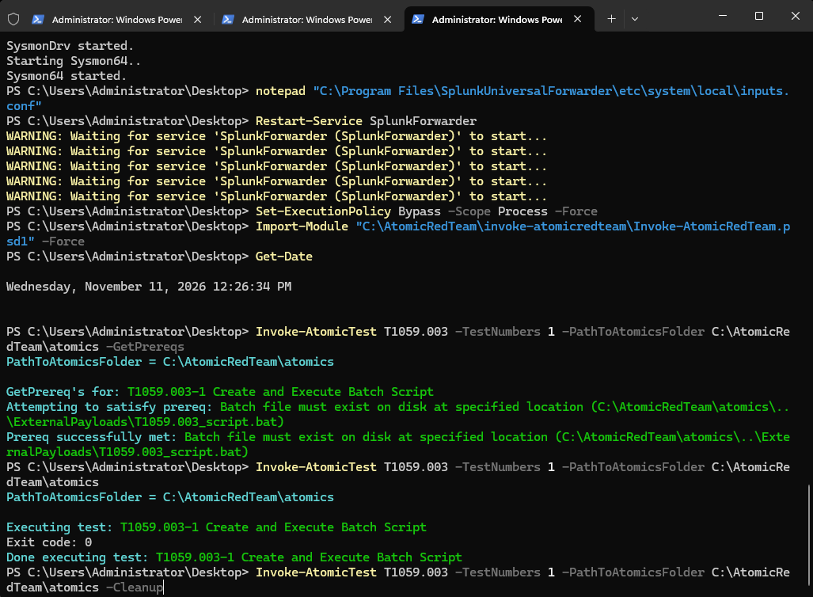
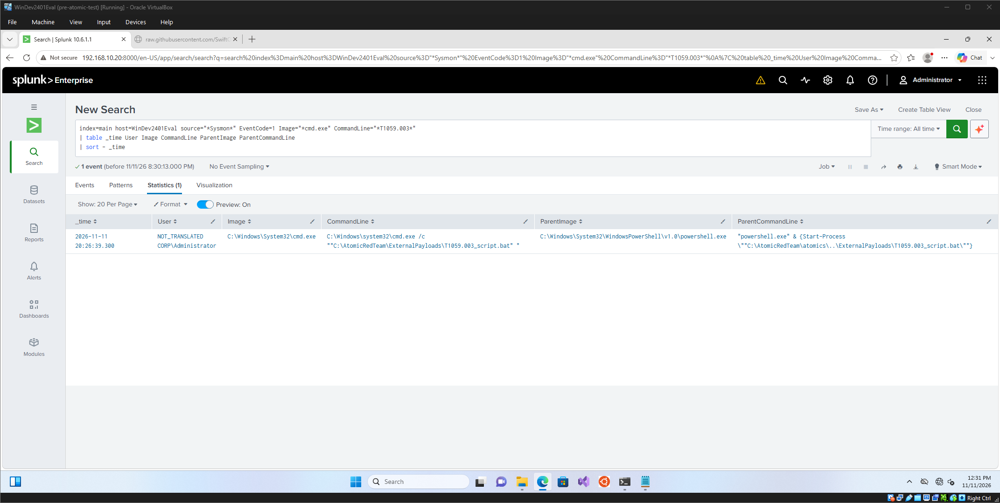
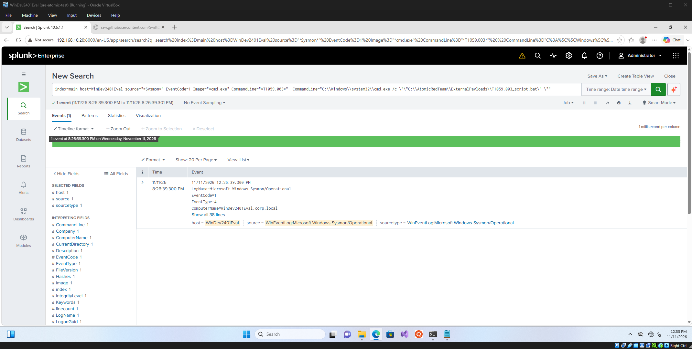

# Atomic Red Team Test 01: Windows Command Shell (T1059.003)

## Objective

Validate that the SOC Home Lab can detect command-shell execution using Sysmon telemetry forwarded to Splunk.

## Technique

| Field | Value |
|---|---|
| MITRE ATT&CK Technique | Command and Scripting Interpreter: Windows Command Shell |
| Technique ID | T1059.003 |
| Atomic Test | T1059.003, Test #1 (Create and Execute Batch Script) |
| Tactic | Execution |

## Environment

- Target system: CLIENT01, domain-joined Windows client (Splunk host name: WinDev2401Eval)
- Telemetry: Sysmon v15.22 with the SwiftOnSecurity configuration, forwarded to Splunk by the Universal Forwarder
- Splunk index: main
- Test date and time: 2026-11-11, 12:26 PM (CLIENT01 local clock). Splunk displayed the event at 20:26, an 8-hour display offset from the endpoint clock.
- Isolation: CLIENT01 sits on the isolated CorpLAN network with no internet access. Tools were transferred through a VirtualBox shared folder.

## What I Ran

```powershell
Invoke-AtomicTest T1059.003 -TestNumbers 1 -PathToAtomicsFolder C:\AtomicRedTeam\atomics -GetPrereqs
Invoke-AtomicTest T1059.003 -TestNumbers 1 -PathToAtomicsFolder C:\AtomicRedTeam\atomics
Invoke-AtomicTest T1059.003 -TestNumbers 1 -PathToAtomicsFolder C:\AtomicRedTeam\atomics -Cleanup
```

The test creates a batch file containing the command `dir` and launches it through PowerShell's `Start-Process`, causing `cmd.exe` to run the script. It finished with exit code 0, and the cleanup step removed the batch file afterward.







## What the Logs Showed

| Field | Value |
|---|---|
| Event ID | Sysmon Event ID 1 (process creation) |
| Image | C:\Windows\System32\cmd.exe |
| CommandLine | cmd.exe /c ""C:\AtomicRedTeam\ExternalPayloads\T1059.003_script.bat"" |
| ParentImage | C:\Windows\System32\WindowsPowerShell\v1.0\powershell.exe |
| User | CORP\Administrator |
| Timestamp | 2026-11-11 20:26:39 (Splunk display time) |

Sysmon recorded `powershell.exe` launching `cmd.exe` with `/c` and the path to a batch file. This process chain is consistent with the Windows Command Shell technique (T1059.003), and the parent-child relationship and full command line are what an analyst would use to investigate it.

## Detection Query

```spl
index=main host=WinDev2401Eval source="*Sysmon*" EventCode=1 Image="*cmd.exe" CommandLine="*T1059.003*"
| table _time User Image CommandLine ParentImage ParentCommandLine
| sort - _time
```

Changes from my original draft:
- `host=CLIENT01` became `host=WinDev2401Eval`, because Splunk indexes events under the Windows computer name.
- I added `source="*Sysmon*"` because `EventCode=1` alone also matches an unrelated Windows System log event.
- The `T1059.003` string in the command line is specific to this atomic test, which makes it a validation query, not a general detection.

## Alert Logic

Proposed, not yet implemented. Trigger when `cmd.exe` is launched by `powershell.exe` or another script host with `/c` and a `.bat` or `.cmd` path, especially from a user-writable location such as a temp or downloads folder. Run it on a scheduled search every 5 to 15 minutes over the previous window. I would start at low severity and raise it if the user, host, or location is unusual or if several matches occur in a short period.

## False Positives

Administrators running scripts, software installers, login scripts, scheduled tasks, and deployment tools can all produce this process chain. I would separate them from malicious use by checking the parent process, the user account, the script's location, the time of day, and whether the same script has run on other hosts.

## Limitations

- This was a single controlled test in an isolated lab.
- Sysmon was not installed on CLIENT01 when I first ran the test, so that run was not recorded. I installed Sysmon, added the Sysmon log to the forwarder's inputs, and re-ran the test.
- The query above matches the test's own file name. A real attacker would not use that name, so a general detection needs to match behavior (parent, arguments, location) instead.
- Event ID 1 alone does not prove malicious activity. Context is required.

## Result

| Item | Outcome |
|---|---|
| Telemetry generated | Yes |
| Visible in Splunk | Yes |
| Detection query worked | Yes, after filtering by Sysmon source and using the correct host name |
| ATT&CK status | Validated with simulation |

## Next Steps

- Test T1059.001 (PowerShell).
- Write and test a behavior-based version of the detection that doesn't depend on the test's file name.
- Create a scheduled Splunk alert from it.
- Tune the query to reduce false positives.
